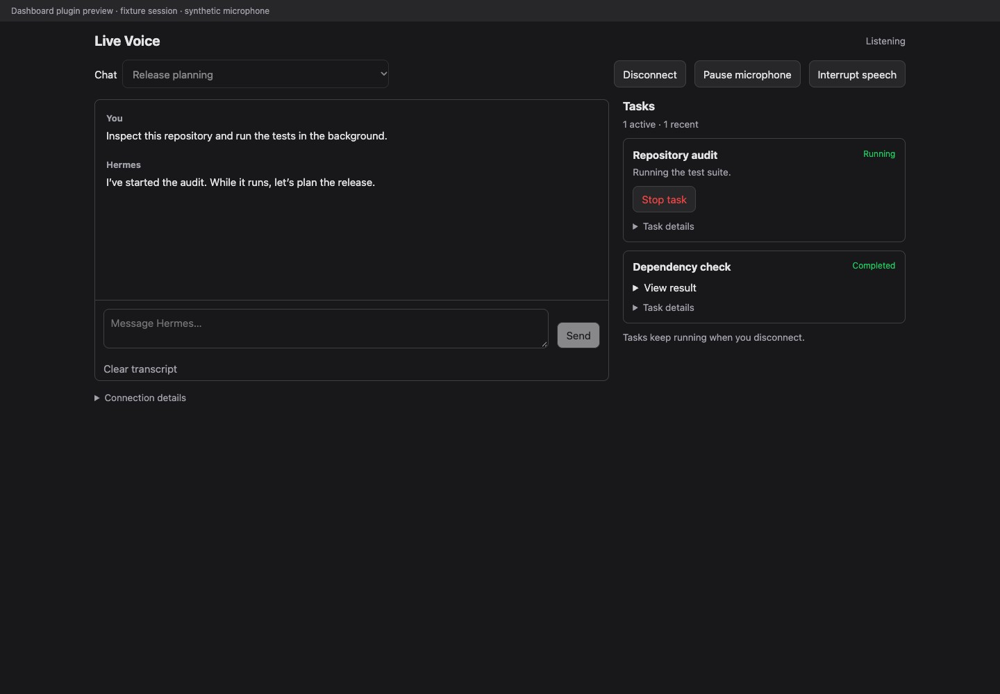

# Hermes Live Voice

**Talk to [Hermes Agent](https://github.com/NousResearch/hermes-agent) while it works.** Ask for something big, keep talking, and hear when it's done.

[](https://github.com/bielcarpi/hermes-live-voice/actions/workflows/ci.yml)
[](https://www.npmjs.com/package/hermes-live-voice)
[](https://github.com/bielcarpi/hermes-live-voice/stargazers)



Most voice assistants go quiet while the agent works. Hermes Live Voice hands long work to Hermes in the background so the conversation keeps going. When a task finishes, you hear about it and the result is waiting in Chat.

- **Built into Hermes.** A voice bar in the Hermes Dashboard's own Chat, not a separate app.
- **A real conversation.** It listens continuously. Talk over it to interrupt, or pause the microphone.
- **Background tasks.** Delegate by voice, follow progress, and hear when work is done. Tasks and results survive voice disconnects and gateway restarts.
- **Your choice of voice.** OpenAI Realtime, Gemini Live, or local speech on Apple Silicon.
- **Self-hosted.** One npm package and a private gateway on your machine, with your Hermes and your keys.

## Quick start

You need Hermes Agent 0.20.0+, Node.js 20+, and an OpenAI API key with Realtime access. For Gemini or local voice, see [Pick a voice](#pick-a-voice).

```sh
npm install --global hermes-live-voice
hermes-live setup
hermes dashboard
```

Setup asks for your key, installs the Dashboard plugin, and starts the gateway.

Open **Chat**, select a conversation, press **Start voice**, and talk. Try:

> Run the tests in the background. While that runs, help me plan the release.

Open **Tasks** to see progress and results. Ending voice doesn't stop the work; **Stop task** does.

## Pick a voice

| Voice | Setup | Needs |
| --- | --- | --- |
| OpenAI Realtime (default) | `hermes-live setup` | `OPENAI_API_KEY` |
| Gemini Live | `hermes-live setup --provider gemini` | `GEMINI_API_KEY` |
| Local | `hermes-live setup --provider local` | Apple Silicon, 12 GB+ memory, [uv](https://docs.astral.sh/uv/) |

Local voice runs [Hugging Face speech-to-speech](https://github.com/huggingface/speech-to-speech) on your Mac, so speech recognition and synthesis need no provider key. The first setup downloads the models; latency depends on free memory. Other platforms can point the gateway at their own speech-to-speech server. See [setup](docs/setup.md#local-voice).

## How it works

The voice provider handles speech and turn-taking. Hermes owns the conversation, memory, tools, and task execution. A small gateway between them keeps task progress and results on disk.

Good to know:

- Voice attaches to a saved chat. Hermes's plugin SDK can't reach an unsaved chat yet, and voice turns appear in the transcript when you reopen the conversation.
- Tasks run one at a time by default.
- If Hermes Agent itself restarts, work in progress is lost. Those tasks show as `unknown` instead of a guessed result.
- Tasks that need approval are stopped, never auto-approved.
- The gateway listens on localhost. Exposing it on a network needs authentication, TLS, and an allowed origin.

More: [Architecture](docs/architecture.md) · [Background tasks](docs/background-tasks.md) · [Security](docs/security.md) · [Browser SDK](docs/ui-integration.md) · [Client protocol](docs/client-protocol.md)

## Troubleshooting

```sh
hermes-live doctor        # diagnose and print the fix
hermes-live launch-check  # check plugin, gateway, provider, and Hermes worker
```

To update, reinstall the package, run `hermes-live upgrade`, and restart Hermes Dashboard. Your provider settings are kept. [Setup and operations](docs/setup.md) covers services, Docker, remote endpoints, and support bundles.

## Contributing

Bug reports, provider test results, and pull requests are welcome. Start with [contributing](CONTRIBUTING.md) and open an issue before a large change. If Hermes Live Voice is useful to you, a star helps other Hermes users find it.

[MIT](LICENSE). A community project, not affiliated with Nous Research.
